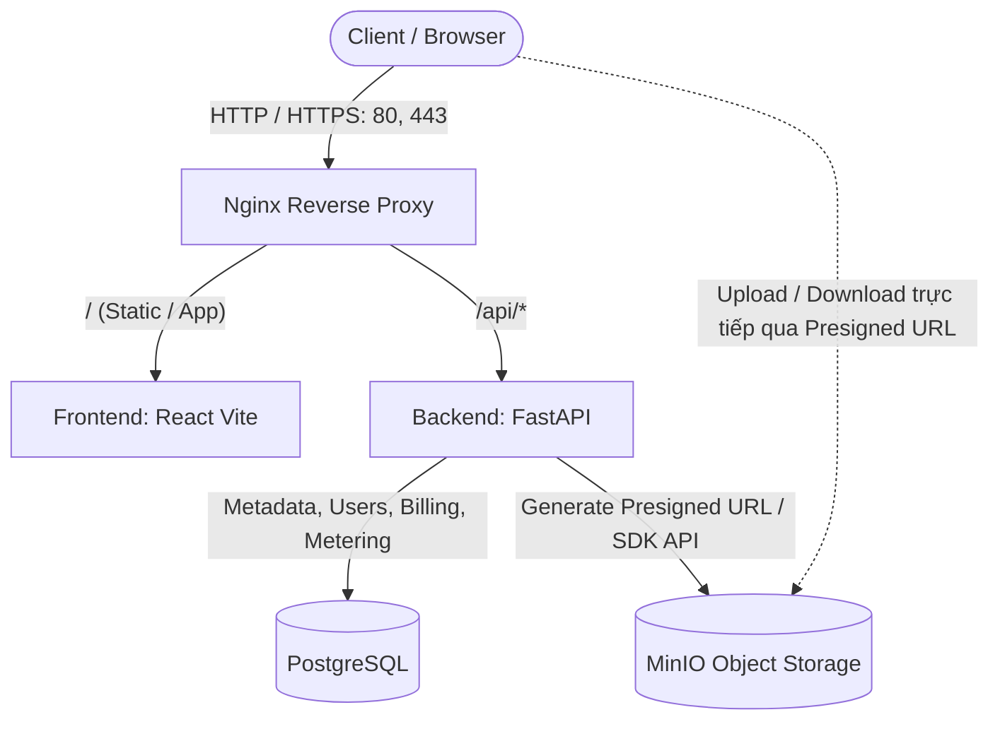
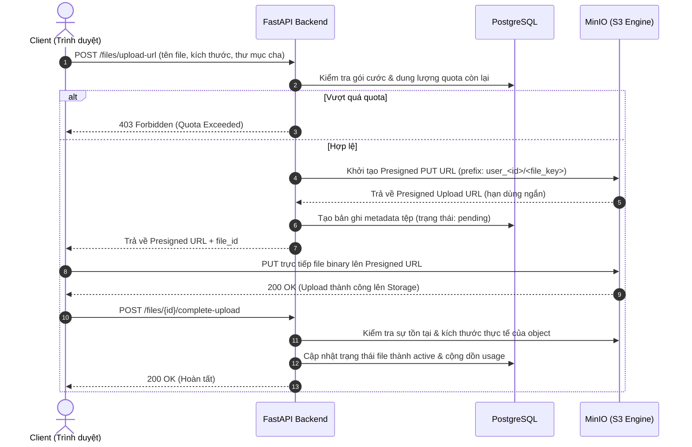

<!-- Tên dự án (có thể thay đổi nếu nhóm chốt tên khác) -->
<!-- PROJECT_NAME: CloudVault -->

# CloudVault - Hệ thống Cloud Data Storage

[](https://github.com/num153/cloudvault)
[](https://github.com/num153/cloudvault)
[](LICENSE)
[](https://www.python.org/)
[](https://fastapi.tiangolo.com/)
[](https://react.dev/)
[](https://vitejs.dev/)
[](https://www.postgresql.org/)
[](https://min.io/)
[](https://www.docker.com/)
[](https://nginx.org/)
[](https://aws.amazon.com/)
<!-- TODO: CI badge - Thêm badge GitHub Actions khi tạo workflow: [](https://github.com/num153/cloudvault/actions) -->

> **Lưu ý:** Repository GitHub chính thức của nhóm tại [github.com/num153/cloudvault](https://github.com/num153/cloudvault). Giấy phép hiện để mặc định là MIT, nhóm có thể điều chỉnh theo quy định môn học.

---

## Mục lục
- [1. Giới thiệu](#1-giới-thiệu)
- [2. Tính năng chính](#2-tính-năng-chính)
- [3. Kiến trúc tổng quan](#3-kiến-trúc-tổng-quan)
- [4. Tech Stack](#4-tech-stack)
- [5. Cấu trúc thư mục](#5-cấu-trúc-thư-mục)
- [6. Yêu cầu môi trường](#6-yêu-cầu-môi-trường)
- [7. Hướng dẫn chạy Local](#7-hướng-dẫn-chạy-local)
- [8. Biến môi trường](#8-biến-môi-trường)
- [9. Triển khai lên AWS Learner Lab](#9-triển-khai-lên-aws-learner-lab)
- [10. Quy trình làm việc Git](#10-quy-trình-làm-việc-git)
- [11. Phân công thành viên](#11-phân-công-thành-viên)
- [12. Lộ trình thực hiện (3 tuần)](#12-lộ-trình-thực-hiện-3-tuần)
- [13. Tài liệu liên quan](#13-tài-liệu-liên-quan)
- [14. Giấy phép](#14-giấy-phép)

---

## 1. Giới thiệu

**CloudVault** là đề tài bài tập lớn môn **Điện toán đám mây** (thực hiện bởi nhóm 3 sinh viên trong vòng 3 tuần). Dự án xây dựng một hệ thống lưu trữ dữ liệu đám mây (Cloud Data Storage) thu nhỏ, cho phép người dùng tự đăng ký tài khoản, tải lên, quản lý và chia sẻ tệp tin an toàn. 

Hệ thống tích hợp cơ chế đo lường mức sử dụng tài nguyên (metering) và tự động tính cước (billing) theo các gói dịch vụ định sẵn. Toàn bộ giải pháp được thiết kế tối ưu và đóng gói bằng Docker Compose để triển khai trên hạ tầng giới hạn của **AWS Academy Learner Lab**.

---

## 2. Tính năng chính

- **Đăng ký & Xác thực:**
  - Đăng ký tài khoản (tự động gán gói Free và khởi tạo không gian lưu trữ riêng), đăng nhập với JWT.
  - Mã hóa mật khẩu an toàn (bcrypt/argon2), hỗ trợ đăng xuất và xem thông tin cá nhân.
- **Quản lý tệp & thư mục:**
  - Tải lên (upload) và tải xuống (download) trực tiếp qua Presigned URL.
  - Tạo thư mục, đổi tên, di chuyển và xóa tệp/thư mục.
  - Phân trang, sắp xếp và tìm kiếm tệp tin theo tên.
  - Cô lập dữ liệu hoàn toàn giữa các người dùng (multi-tenant theo prefix).
- **Chia sẻ tệp:**
  - Tạo liên kết chia sẻ tệp công khai có thời hạn hết hạn.
  - Thu hồi liên kết chia sẻ bất kỳ lúc nào.
- **Gói dịch vụ & Quota:**
  - Phân cấp gói dịch vụ (Free, Basic, Pro) với hạn mức dung lượng khác nhau.
  - Hiển thị thanh dung lượng đã dùng / hạn mức theo thời gian thực.
  - Kiểm tra và tự động chặn upload khi người dùng vượt mức quota của gói.
  - Cho phép người dùng chuyển đổi nâng cấp / hạ cấp gói cước.
- **Đo lường mức sử dụng (Metering):**
  - Ghi nhận biến động dung lượng lưu trữ (storage bytes) khi upload/xóa.
  - Ghi nhận dung lượng tải xuống (egress bytes) và số lượt request.
  - Job định kỳ tổng hợp số liệu usage theo ngày/tháng để làm cơ sở tính phí.
- **Billing & Thanh toán Sandbox:**
  - Tự động sinh hóa đơn cuối chu kỳ gồm phí gói và phí vượt mức (nếu có).
  - Thanh toán hóa đơn qua cổng thanh toán thử nghiệm (Sandbox).
  - Quản lý lịch sử hóa đơn và trạng thái thanh toán (Paid / Unpaid).
- **Quản trị hệ thống (Admin):**
  - Trang dashboard dành riêng cho Admin quản lý danh sách người dùng (khóa/mở khóa tài khoản).
  - Quản lý thông tin và bảng giá các gói cước.
  - Xem thống kê tổng quan: tổng số người dùng, dung lượng lưu trữ toàn hệ thống, doanh thu dự kiến.

---

## 3. Kiến trúc tổng quan

Hệ thống được thiết kế theo mô hình tách biệt dữ liệu:
- **PostgreSQL:** Lưu trữ toàn bộ dữ liệu nghiệp vụ bao gồm thông tin người dùng, metadata tệp (tên, kích thước, đường dẫn logic), gói cước, quota, nhật ký đo lường (metering) và hóa đơn thanh toán (billing).
- **MinIO Object Storage:** Chỉ lưu trữ nội dung nhị phân của tệp tin. Toàn bộ tệp được đặt trong một S3 bucket duy nhất, mỗi người dùng sở hữu một không gian độc lập theo tiền tố `user_<id>/`.
- **Luồng Presigned URL:** Trình duyệt gửi yêu cầu lên Backend để xin cấp URL có chữ ký; sau đó upload/download trực tiếp với MinIO nhằm tránh quá tải CPU và băng thông của server Backend.

### 3.1. Sơ đồ các thành phần hệ thống



### 3.2. Sơ đồ luồng Upload tệp bằng Presigned URL



---

## 4. Tech Stack

| Thành phần | Công nghệ | Vai trò trong hệ thống |
| --- | --- | --- |
| **Backend** | FastAPI (Python) | Xử lý REST API, xác thực JWT, kiểm tra quota, tính cước và sinh Presigned URL S3 |
| **Frontend** | React (Vite) | Xây dựng giao diện web tương tác cho User (File Explorer, Billing) và Admin |
| **Database** | PostgreSQL | Lưu trữ quan hệ: tài khoản, phân quyền, metadata tệp, bảng giá, usage và hóa đơn |
| **Object Storage**| MinIO (S3 API) | Lưu trữ nhị phân các file của người dùng, mount trực tiếp trên ổ cứng EBS của EC2 |
| **Reverse Proxy** | Nginx | Đón tiếp traffic tại cổng 80/443, định tuyến sang Frontend, Backend và MinIO |
| **Đóng gói** | Docker & Docker Compose | Đóng gói toàn bộ các dịch vụ thành multi-container, đảm bảo tính nhất quán |
| **Hạ tầng Cloud** | AWS Academy Learner Lab | Cung cấp máy ảo EC2 và volume lưu trữ EBS gp3 để vận hành hệ thống |

---

## 5. Cấu trúc thư mục

```text
cloudvault/
├── backend/                  # Mã nguồn Backend API (FastAPI)
│   ├── Dockerfile            # Containerfile cho backend
│   └── README.md             # Tài liệu chi tiết nội bộ backend
├── frontend/                 # Mã nguồn Frontend Web (React + Vite)
│   ├── Dockerfile            # Containerfile cho frontend
│   └── README.md             # Tài liệu chi tiết nội bộ frontend
├── infra/                    # Cấu hình hạ tầng và kịch bản triển khai
│   ├── nginx/
│   │   └── nginx.conf        # Cấu hình Nginx reverse proxy
│   └── scripts/
│       └── ec2-user-data.sh  # Script cài đặt Docker & khởi động trên AWS EC2
├── docs/                     # Tài liệu thiết kế hệ thống
│   ├── SRS.md                # Đặc tả yêu cầu phần mềm chi tiết
│   ├── architecture.md       # Tài liệu thuyết minh kiến trúc
│   └── api.md                # Đặc tả chi tiết các REST API endpoints
├── docker-compose.yml        # Định nghĩa các dịch vụ Docker (App, DB, S3, Proxy)
├── .env.example              # Mẫu các biến môi trường
├── .gitignore                # Danh sách file/thư mục không commit vào Git
└── README.md                 # Tài liệu hướng dẫn chung của dự án
```

---

## 6. Yêu cầu môi trường

Để chạy và phát triển dự án, máy phát triển cần cài đặt sẵn:
- **Git:** `TODO: điền phiên bản (ví dụ >= 2.38)`
- **Docker Desktop:** `TODO: điền phiên bản (ví dụ >= 24.0)`
- **Docker Compose:** `TODO: điền phiên bản (ví dụ >= 2.20)`
- **Node.js:** `TODO: điền phiên bản (ví dụ >= 18.x LTS)` *(dùng khi chạy độc lập frontend)*
- **Python:** `TODO: điền phiên bản (ví dụ >= 3.10)` *(dùng khi chạy độc lập backend)*

---

## 7. Hướng dẫn chạy Local

Thực hiện các bước sau để khởi chạy toàn bộ hệ thống bằng Docker Compose:

1. **Clone mã nguồn:**
   ```bash
   git clone https://github.com/num153/cloudvault.git
   cd cloudvault
   ```

2. **Thiết lập biến môi trường:**
   ```bash
   cp .env.example .env
   ```
   *(Mở `.env` và tùy chỉnh các thông số phù hợp nếu cần thiết).*

3. **Khởi chạy hệ thống bằng Docker Compose:**
   ```bash
   docker compose up -d --build
   ```

4. **Kiểm tra và truy cập các dịch vụ:**
   - **Frontend App:** `http://localhost:TODO_PORT_FRONTEND` (hoặc `http://localhost` qua Nginx)
   - **Backend API Docs (Swagger UI):** `http://localhost:TODO_PORT_BACKEND/docs` (hoặc `http://localhost/docs`)
   - **MinIO Console (Quản trị Storage):** `http://localhost:TODO_PORT_MINIO_CONSOLE` (Mặc định: `9001`)
   - **MinIO S3 API Endpoint:** `http://localhost:TODO_PORT_MINIO_API` (Mặc định: `9000`)

---

## 8. Biến môi trường

Dưới đây là các biến môi trường cấu hình chính trong `.env.example`. **Tuyệt đối không commit file `.env` chứa mật khẩu thực lên Git.**

| Tên biến | Ý nghĩa / Mục đích | Giá trị mẫu |
| --- | --- | --- |
| `PROJECT_NAME` | Tên dự án | `CloudVault` |
| `ENVIRONMENT` | Môi trường chạy | `development` / `production` |
| `POSTGRES_DB` | Tên cơ sở dữ liệu PostgreSQL | `cloudvault_db` |
| `POSTGRES_USER` | Tên người dùng database | `cloudvault_user` |
| `POSTGRES_PASSWORD` | Mật khẩu database | `cloudvault_password_example` |
| `POSTGRES_HOST` | Địa chỉ host của database | `postgres` (tên container) |
| `POSTGRES_PORT` | Cổng kết nối PostgreSQL | `5432` |
| `MINIO_ROOT_USER` | Tài khoản admin MinIO | `minioadmin` |
| `MINIO_ROOT_PASSWORD` | Mật khẩu admin MinIO | `miniopassword123` |
| `MINIO_DEFAULT_BUCKET` | Tên bucket S3 dùng chung | `cloudvault-data` |
| `S3_ENDPOINT` | Endpoint kết nối nội bộ tới MinIO | `http://minio:9000` |
| `S3_PUBLIC_ENDPOINT` | Endpoint cho client truy cập Presigned URL | `http://localhost:9000` hoặc `http://<EC2_IP>:9000` |
| `JWT_SECRET_KEY` | Khóa bí mật ký JWT Token | `secret_key_placeholder_change_me` |
| `JWT_ALGORITHM` | Thuật toán ký JWT | `HS256` |
| `ACCESS_TOKEN_EXPIRE_MINUTES` | Thời gian sống của JWT token (phút) | `1440` |
| `VNPAY_TMN_CODE` | Mã website sandbox cổng thanh toán | `TODO: mã TMN test` |
| `VNPAY_HASH_SECRET` | Khóa bí mật sandbox cổng thanh toán | `TODO: hash secret test` |

---

## 9. Triển khai lên AWS Learner Lab

### 9.1. Các bước triển khai
1. **Khởi tạo EC2 Instance:**
   - Đăng nhập vào AWS Academy Learner Lab, mở dịch vụ EC2.
   - Chọn hệ điều hành **Ubuntu 22.04 LTS**, instance type tối ưu chi phí: `t3.medium` (hoặc `t3.small`).
   - Gắn ổ đĩa EBS dung lượng từ 20-30 GB gp3 để lưu trữ OS, Docker containers và dữ liệu MinIO/Postgres.
2. **Cấu hình Security Group:**
   - Mở cổng `80` (HTTP) và `443` (HTTPS) cho `0.0.0.0/0` (truy cập web).
   - Mở cổng `22` (SSH): **chỉ giới hạn cho IP hiện tại của bạn (`My IP`)** để đảm bảo an toàn.
   - **Lưu ý:** Tuyệt đối không mở công khai cổng PostgreSQL (`5432`) hoặc MinIO Console (`9001`) ra Internet. Mọi kết nối đều phải đi qua Nginx hoặc thông qua Presigned URL đã ký.
3. **Cài đặt & Khởi động hệ thống:**
   - SSH vào EC2 instance:
     ```bash
     ssh -i <your-key.pem> ubuntu@<EC2_PUBLIC_IP>
     ```
   - Chạy script chuẩn bị [infra/scripts/ec2-user-data.sh](infra/scripts/ec2-user-data.sh) hoặc cài đặt Docker/Docker Compose thủ công.
   - Clone repo, copy `.env.example` sang `.env`, cập nhật `S3_PUBLIC_ENDPOINT=http://<EC2_PUBLIC_IP>:9000`.
   - Khởi động:
     ```bash
     docker compose up -d --build
     ```

### 9.2. Lưu ý sống còn với môi trường Learner Lab
- **IP thay đổi:** Mỗi khi tắt và bật lại Lab Session, Public IP của EC2 sẽ thay đổi. Hãy nhớ cập nhật lại `S3_PUBLIC_ENDPOINT` trong `.env` tương ứng với IP mới.
- **Tiết kiệm ngân sách:** Lab có hạn mức ~100 USD. Luôn **Stop EC2 Instance** khi kết thúc phiên làm việc để không bị cạn ngân sách.
- **Sao lưu định kỳ:** Dùng lệnh `pg_dump` để định kỳ sao lưu cơ sở dữ liệu Postgres ra máy cá nhân hoặc đẩy file backup lên Git/S3.
- **Phục hồi nhanh sau khi Lab reset:** Nhờ toàn bộ cấu hình đã được đóng gói bằng Docker Compose, nếu lab bị reset toàn bộ, bạn chỉ cần tạo lại 1 EC2 mới, clone repo và chạy `docker compose up -d --build` là hệ thống hoạt động trở lại trong dưới 15 phút.

---

## 10. Quy trình làm việc Git

Để đảm bảo tiến độ và chất lượng mã nguồn trong 3 tuần, nhóm tuân thủ nghiêm ngặt quy trình:

- **Bảo vệ nhánh chính:** Nhánh `main` luôn là nhánh ổn định, chạy được. **Tuyệt đối không push code trực tiếp lên `main`**.
- **Phát triển theo nhánh tính năng:** Mọi tính năng hay sửa lỗi đều tách nhánh riêng từ `main`:
  - Tính năng mới: `feature/<ten-tinh-nang>` (ví dụ: `feature/auth-jwt`, `feature/s3-presigned`)
  - Sửa lỗi: `fix/<ten-loi>` (ví dụ: `fix/quota-check`)
- **Pull Request (PR):** Khi hoàn thành, tạo Pull Request vào `main`. Phải có ít nhất **1 thành viên khác review** và chấp thuận mới được merge.
- **Quy ước đặt tên Commit:** Tuân thủ Conventional Commits:
  - `feat: <nội dung>` (Thêm tính năng mới)
  - `fix: <nội dung>` (Sửa lỗi)
  - `docs: <nội dung>` (Cập nhật tài liệu)
  - `refactor: <nội dung>` (Tối ưu mã nguồn)
- **Đồng bộ mã nguồn:** Thường xuyên thực hiện `git pull --rebase origin main` trên nhánh tính năng để giảm thiểu xung đột (conflict).

---

## 11. Phân công thành viên

| Họ và tên | MSSV | Vai trò chính | Nhiệm vụ đảm nhiệm |
| --- | --- | --- | --- |
| `TODO: Họ tên SV 1` | `TODO: MSSV 1` | Hạ tầng & DevOps | Setup AWS EC2, Security Group, Docker Compose, Nginx, MinIO, backup/restore |
| `TODO: Họ tên SV 2` | `TODO: MSSV 2` | Backend & Billing | Xây dựng FastAPI, kết nối Postgres, presigned URL S3, metering, billing sandbox |
| `TODO: Họ tên SV 3` | `TODO: MSSV 3` | Frontend & Tích hợp | Xây dựng giao diện React (Vite), tích hợp API, thanh tiến trình upload, dashboard |

---

## 12. Lộ trình thực hiện (3 tuần)

### Tuần 1: Thiết kế, Hạ tầng & Nền tảng lõi
- [ ] Hoàn thiện tài liệu SRS, sơ đồ kiến trúc và thiết kế CSDL (PostgreSQL).
- [ ] Thiết lập repository, cấu trúc thư mục chuẩn và Docker Compose cơ bản.
- [ ] Dựng hạ tầng trên AWS Learner Lab (EC2, MinIO, PostgreSQL, Nginx).
- [ ] Backend: Hoàn thiện module Auth (Đăng ký, Đăng nhập JWT, phân quyền User/Admin).
- [ ] Frontend: Khởi tạo khung dự án React (Vite), trang Đăng nhập & Đăng ký.

### Tuần 2: Quản lý tệp, S3 Presigned URL & Quota
- [ ] Backend: Cấp Presigned URL upload/download, phân tách prefix `user_<id>/` trên MinIO.
- [ ] Backend: Viết logic kiểm tra Quota theo gói cước (chặn upload khi đầy).
- [ ] Frontend: Xây dựng trình duyệt tệp (File Explorer), upload/download trực tiếp tới MinIO kèm progress bar.
- [ ] Frontend: Hiển thị thanh trạng thái Quota và thông tin gói cước.
- [ ] Tích hợp tính năng tạo link chia sẻ file có hạn dùng.

### Tuần 3: Metering, Billing Sandbox, Tối ưu & Báo cáo
- [ ] Backend: Viết background job định kỳ đo lường mức sử dụng (metering: storage, egress).
- [ ] Backend: Tính cước tự động cuối kỳ và tích hợp cổng thanh toán Sandbox (VNPay/MoMo/Stripe test).
- [ ] Frontend: Giao diện lịch sử hóa đơn, thanh toán cước phí và Dashboard thống kê cho Admin.
- [ ] Kiểm thử toàn diện (cô lập dữ liệu multi-tenant, vượt quota, phục hồi sau khi lab tắt).
- [ ] Đóng gói báo cáo cuối kỳ, hoàn thiện slide thuyết trình và chuẩn bị kịch bản demo.

---

## 13. Tài liệu liên quan

- [Tài liệu Đặc tả yêu cầu phần mềm (SRS)](docs/SRS.md)
- [Thuyết minh Kiến trúc hệ thống](docs/architecture.md)
- [Tài liệu Đặc tả REST API](docs/api.md)

---

## 14. Giấy phép

Dự án được phân phối dưới giấy phép `MIT License` (Nhóm có thể tùy chỉnh lại theo quy định của môn học). Xem chi tiết tại tệp `LICENSE` (nếu có).
